# RFP Insight: Agentic RFP Evaluation and Supplier Ranking

RFP Insight is a Streamlit app that reads supplier responses to an RFP (PDF, DOCX or legacy DOC). An AI agent scores each response against the criteria for its procurement category and quotes evidence for every score. Plain Python then ranks the suppliers with fixed formulas: absolute weighted score, peer benchmarks, the Peer Performance Index (PPI) and the required tie-break rules. Each run is saved to SQLite and can be downloaded as JSON.

**Stack:** Streamlit, SQLite, OpenAI (JSON mode), LangGraph (orchestrator), LangSmith (tracing, optional), PyMuPDF, python-docx, Pydantic and Altair.

> **The LLM judges the content; Python does the maths.** The AI sees one supplier at a time and returns only criterion scores, justifications and evidence quotes. Validation, totals, benchmarks, PPI, tie-breaks and ranks are all calculated in Python. The same validated scores therefore always produce the same ranking.

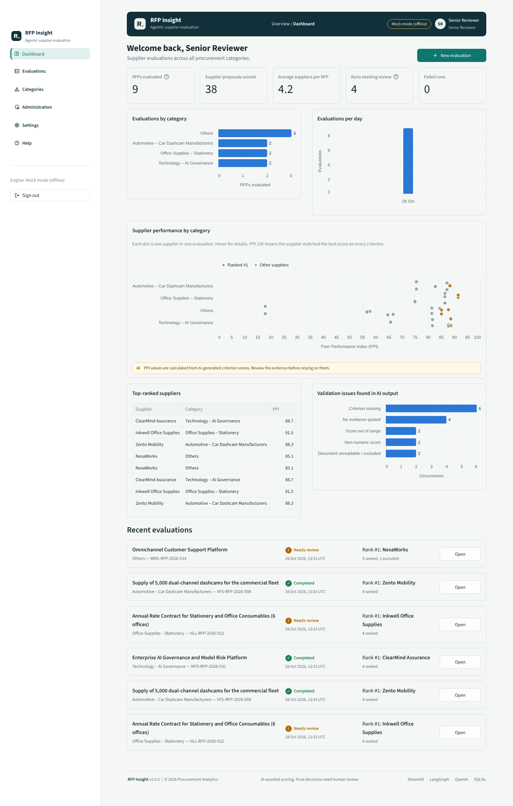

---

## 1. Run it locally (Windows cmd)

```cmd
cd %USERPROFILE%\Documents\rfp-evaluator
python -m venv .venv
.venv\Scripts\activate.bat
pip install -r requirements-dev.txt
python scripts\init_db.py
streamlit run app.py
```

On macOS or Linux, use `source .venv/bin/activate` and forward slashes instead.

To get started:

1. Sign in as `reviewer` / `reviewer123` or `evaluator` / `evaluator123`.
2. On the empty dashboard, click **Create demo evaluations** to add one mock evaluation per category. You can also go to **Evaluations › New evaluation**, pick a category and click **Load sample proposals**.
3. Run the tests with `pytest -q` (34 tests).

Useful commands:

| Task | Command |
|---|---|
| Reset the database | `python scripts\init_db.py --reset` |
| Reset and add demo evaluations | `python scripts\init_db.py --reset --demo` |
| Rebuild the sample proposals | `python scripts\generate_samples.py` (needs LibreOffice for the `.doc` files; otherwise it keeps the existing ones) |
| Re-export the sample JSON | `python scripts\export_sample_run.py` (add `--openai` to use the real model) |

> **Upgrading from version 1:** the first start backs up your old database as `data\rfp_evaluation.v1-backup-<timestamp>.db` and creates a new one with categories. Old runs are not migrated.

## 2. Choosing the AI engine

Go to **Settings › AI engine**:

- **Mock mode** is the default when no key is configured. It is offline and free. It returns realistic, evidence-backed scores for the bundled samples and a simple keyword estimate for any other file.
- **OpenAI:**
  1. Paste an API key and click **Connect and load models**. The app lists the chat models your key can use, with recommended ones first.
  2. Pick a model and click **Test connection**.
  3. Click **Use this model**.

The key is kept **only in your browser session**. It is never written to the database, the results JSON or LangSmith. A key in `.streamlit/secrets.toml` is used as the default. Models that reject `temperature` or `seed` (for example reasoning models) are retried without those settings automatically.

### Tracing with LangSmith

Go to **Settings › Tracing**:

1. Turn on **Trace new evaluations in LangSmith**.
2. Enter your LangSmith API key (or use the one from `secrets.toml`), a project name and the region (US or EU).
3. Click **Test connection**, then **Save**.

Each evaluation is then recorded as one trace: every LangGraph node, tool call and OpenAI request, with its inputs, outputs and timings. The trace link is saved with the run:

- **Results** shows **View trace in LangSmith** next to the run details.
- **Run history** has an **Open trace** column, and **Category insights** shows a **Trace** button on each run.

If the link can't be fetched straight after the run (for example LangSmith is still processing the trace), Results shows **Get LangSmith link** to look it up again. The key is kept only in your browser session. Supplier files and OpenAI keys are never sent to traces; extracted text and AI responses are. Runs made with tracing off show "Not traced".

## 3. Deploy on Streamlit Community Cloud

1. Push the folder to a GitHub repository. `data/*.db` and `secrets.toml` are git-ignored.
2. On <https://share.streamlit.io>, click **Create app** and set the main file to `app.py` (Python 3.12).
3. Under **Advanced settings › Secrets**, paste the contents of `.streamlit/secrets.toml.example` with your values. At minimum, set `REVIEWER_PASSWORD` and `EVALUATOR_PASSWORD`.
4. `packages.txt` installs `antiword` for the best `.doc` support. Without it, a built-in reader is used.

> Storage on Streamlit Cloud is temporary. The database is re-seeded whenever the app restarts.

## 4. What's in the app

| Area | What you can do |
|---|---|
| **Dashboard** | KPIs; evaluations by category and over time; a PPI distribution per category (winners highlighted); top suppliers; validation issues found in AI output; recent evaluations |
| **New evaluation** | Choose a **category** (Technology – AI Governance, Office Supplies – Stationery, Automotive – Car Dashcam Manufacturers, Others). Enter the RFP title and reference. Add or remove supplier rows, each with a name, a submission date (defaults to today) and a past performance rating (0–100, used for tie-breaks). Upload a PDF, DOCX or DOC per row, or bulk-add several files. Errors are shown under each row. |
| **Results** | Winner card, leaderboard and PPI chart. Each supplier has a scorecard where every criterion shows its **score next to the highlighted document snippet** it came from, with page and section. **Open in document** shows the PDF page with the quote highlighted, or a wider text view for Word files. Also: peer comparison heatmap, benchmarks, run details, tie-break explanations, raw AI output and JSON export. |
| **Run history** | Filter by category, status, user, date and text. Open any run or export the list as CSV. |
| **Category insights** | For each category: number of evaluations, average PPI, every RFP with its winner and leaderboard, and the best result per supplier across RFPs |
| **Evaluation criteria** | Criteria per category. Senior reviewers can edit weights, maximum scores, descriptions and active status, or add criteria. Active weights must total 100%, and every save requires a reason. Each field change is kept in the **change history**. |
| **Audit log** (reviewers) | Sign-ins, failed sign-ins, password changes and all criteria changes |
| **My account** | Change your password. Rules: at least 8 characters, with a letter and a number, and not containing your username. |
| **AI disclaimer** | Shown on results, scorecards, dashboard PPI charts and category insights, and stored in every exported JSON. Mock-mode runs carry their own notice. |

## 5. Architecture

| Component | File | Responsibility |
|---|---|---|
| Orchestrator Agent | `rfp/agents/orchestrator.py` | LangGraph state graph that creates the `RFP_RUN_ID` and calls every step in order. It routes to `fail_run` when nothing is left to rank. |
| Document Tool | `rfp/tools/document_tool.py` | Detects the real file type from its content (a renamed file is rejected). Extracts PDF text with page markers, DOCX text with headings and tables, and DOC text via antiword or the built-in Word 97 reader. Rejects scanned or empty files. |
| Evaluation Agent | `rfp/agents/evaluation_agent.py`, `rfp/llm.py` | One OpenAI call per supplier in JSON mode, with temperature 0 and a fixed seed. Retries once if the JSON is invalid. Results are cached by (document, criteria, model, prompt). |
| Validation Tool | `rfp/tools/validation_tool.py` | Repairs the AI output and records a warning for every change |
| Evidence Tool | `rfp/tools/evidence_tool.py` | Finds each quote in the document by word alignment and returns the page, section, offsets and surrounding text |
| Ranking Tool | `rfp/tools/ranking_tool.py` | Absolute score, benchmarks, gaps, relative %, PPI, tie-breaks and ranks |
| Persistence | `rfp/db.py` | Categories, criteria and their audit history, users, audit events, runs, results, original files and the AI cache |
| UI | `app.py`, `ui/` | Header and footer, accordion navigation, pages, charts and evidence viewer |

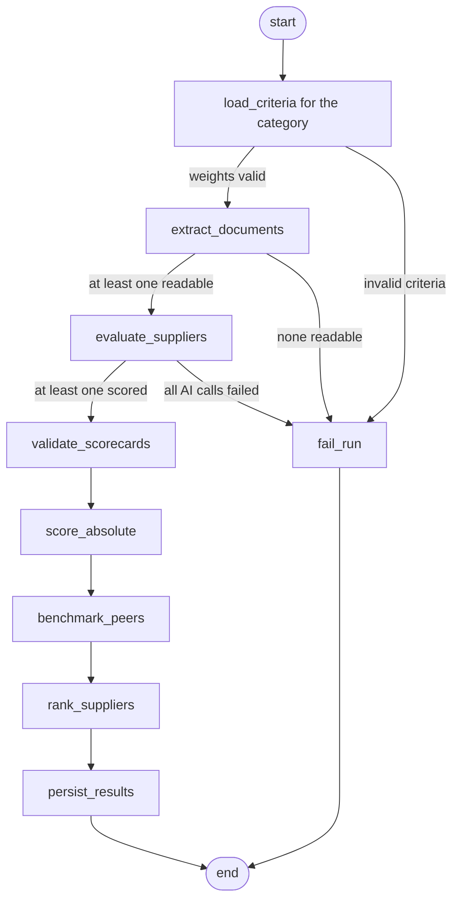

### Database

| Table | Purpose |
|---|---|
| `categories` | Procurement categories (code, group, name, description, whether a description is required) |
| `evaluation_criteria` | Criteria **per category**: name, description, weight, max_score, is_active, updated_by |
| `criteria_change_log` | One row per changed field: old and new value, reviewer, time, reason |
| `users`, `audit_events` | Roles, salted PBKDF2 password hashes, sign-ins and password changes |
| `rfp_runs` | Run ID, category, RFP title and reference, status, engine, criteria snapshot, warnings, full result JSON |
| `supplier_results` | One row per supplier per run (ranked or excluded) with the scorecard JSON |
| `rfp_documents` | Original uploaded files and extracted text, used for the evidence viewer |
| `llm_cache` | Raw AI responses for reproducible re-runs |

## 6. Formulas and tie-breaks

| Metric | Formula |
|---|---|
| Absolute weighted score (0–100) | Σ (scoreᵢ / max_scoreᵢ) × weightᵢ |
| Criterion benchmark | Highest score among ranked suppliers in the run |
| Gap | scoreᵢ − benchmarkᵢ |
| Relative % | scoreᵢ / benchmarkᵢ × 100. If the benchmark is 0, every supplier gets 100. |
| PPI | Σ (relative %ᵢ × weightᵢ) / Σ weightᵢ |

Suppliers are ranked by these rules, in order:

1. Higher PPI (rounded to 4 decimals)
2. Earlier submission date
3. Higher past performance rating
4. Supplier name, A–Z

Ranks run 1…N with no shared ranks. The **Stationery** sample is built so that OfficeNest India and PaperTrail Traders tie on PPI (86.44) and submission date. Rule 3 places OfficeNest first.

## 7. Validation rules

**AI output:**

| Problem | Action |
|---|---|
| Invalid JSON or prose around the JSON | Extract the `{…}` block. If impossible, score all criteria 0 with a warning. |
| Unknown or duplicate criterion | Ignore it, or match by name; keep the first duplicate |
| Non-numeric score (`"excellent"`) | Set to 0 |
| Score given on a different scale (80/100) | Rescale to the criterion's maximum |
| Score outside 0…max | Clip to the range |
| Criterion missing | Score 0 (`imputed_missing`) |
| Evidence missing, or not found in the document | Flag it for manual review |

**Inputs:**

- Category, an RFP title of at least 3 characters, and a description when the category is Others
- 2–12 suppliers
- Unique supplier names (case-insensitive) that contain letters
- Submission date not in the future and no more than 365 days old
- Rating between 0 and 100
- File type PDF, DOCX or DOC, checked against the file content, up to 10 MB
- No duplicate files

A supplier whose file can't be read, or whose AI call fails, is excluded and reported. If no supplier remains, the run is saved as `failed`.

## 8. Sample data (all fictional)

| Category | Suppliers (format) | Design |
|---|---|---|
| Technology – AI Governance | ClearMind Assurance (PDF), Lumora AI (DOCX), TrustGrid Systems (PDF), Kavach Labs (DOC) | Close race between the strongest governance offer and the best value |
| Office Supplies – Stationery | Inkwell (DOCX), PaperTrail (PDF), OfficeNest (PDF), Shree Ganesh (DOC) | **Tie on PPI, broken by tie-break rule 3** |
| Automotive – Car Dashcams | VisionDrive (PDF), RoadEye (DOCX), Kestrel (PDF), Zento Mobility (DOCX) | Best hardware vs best privacy; Zento wins narrowly |
| Others (customer support platform, the original brief) | Apex, BrightPath, NexaWorks, Orbit (PDF, 2 pages each) + Quasar (incomplete) | Original four profiles plus a validation case |
| Error cases | `scanned_proposal.pdf` (no text layer), `renamed_word_file.pdf` (Word file renamed to .pdf) | Exclusion and input validation |

When you load the samples, their submission dates are shifted so the newest is today. The gaps between suppliers are kept, so the tie-breaks always behave the same.

Exported runs are in `samples/`, including `sample_run_validation_cases.json` and `sample_run_stationery_tie_break.json`.

## 9. Demo script (about 4 minutes)

1. Sign in as `evaluator`. Open the dashboard and click **Create demo evaluations**.
2. Go to **New evaluation**, choose **Office Supplies – Stationery**, click **Load sample proposals**, then **Evaluate**.
   - The leaderboard shows the tie-break explanation.
   - Under **Scorecards and evidence**, open a snippet in the document.
3. **Validation and error case:** choose **Others**, tick **Include error examples** and load the samples. Under *Advanced options*, corrupt the AI response for BrightPath Tech, then evaluate. You'll see:
   - Zenith excluded as a scanned PDF
   - Quasar's missing criteria imputed
   - BrightPath's repaired scores flagged
4. **Input errors:** add a row with no file, a duplicate name, or the `renamed_word_file.pdf` error case. Errors appear under each row.
5. Sign in as `reviewer`:
   - Change the AI Governance weights. Save stays disabled until they total 100%, and a reason is required.
   - Show the **Change history** and the **Audit log**.
   - Change your password under **My account**.
6. Under **AI engine**, enter an OpenAI key, load the models, pick one, test it, and re-run an evaluation.

## 10. Assumptions

- Criterion scores use a 0–10 scale by default; the maximum is configurable per criterion. The past performance rating is 0–100.
- The supplier name and dates entered by the user are the source of truth.
- Benchmarks are calculated only across the suppliers ranked in the same run.
- AI output can vary even at temperature 0, so raw responses are cached. You can turn this off under *Advanced options*. Results are deterministic from validation onwards.
- Supplier documents are treated as untrusted. The prompt tells the model to ignore instructions inside them.
- The default passwords are for classroom use. Set your own through secrets, or change them in the app.

## 11. Screenshots

| | |
|---|---|
| 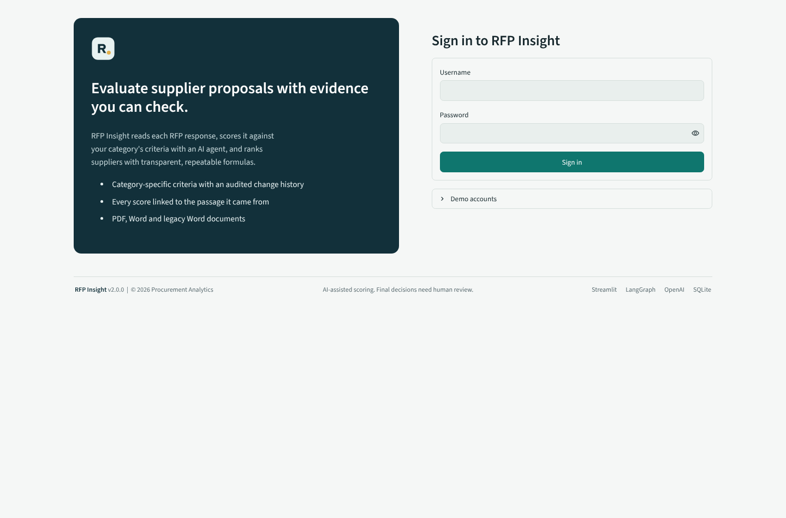 | 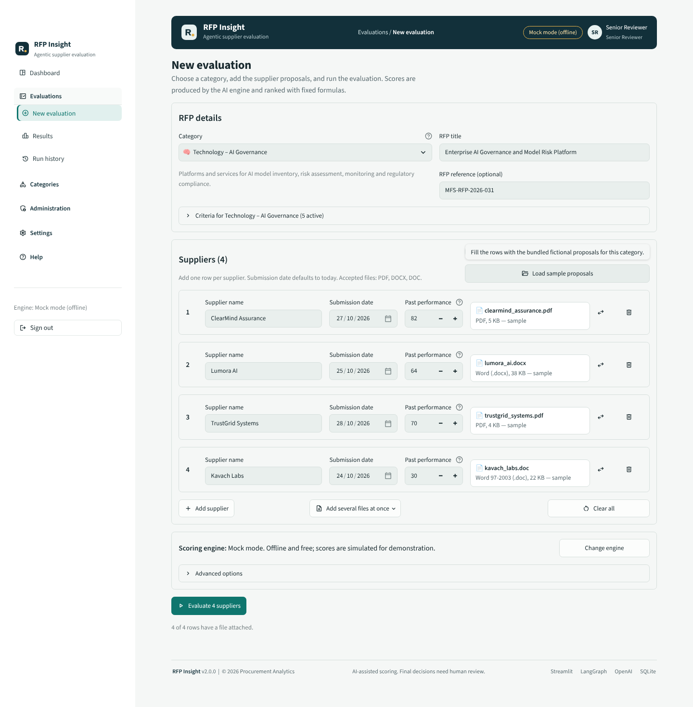 |
| 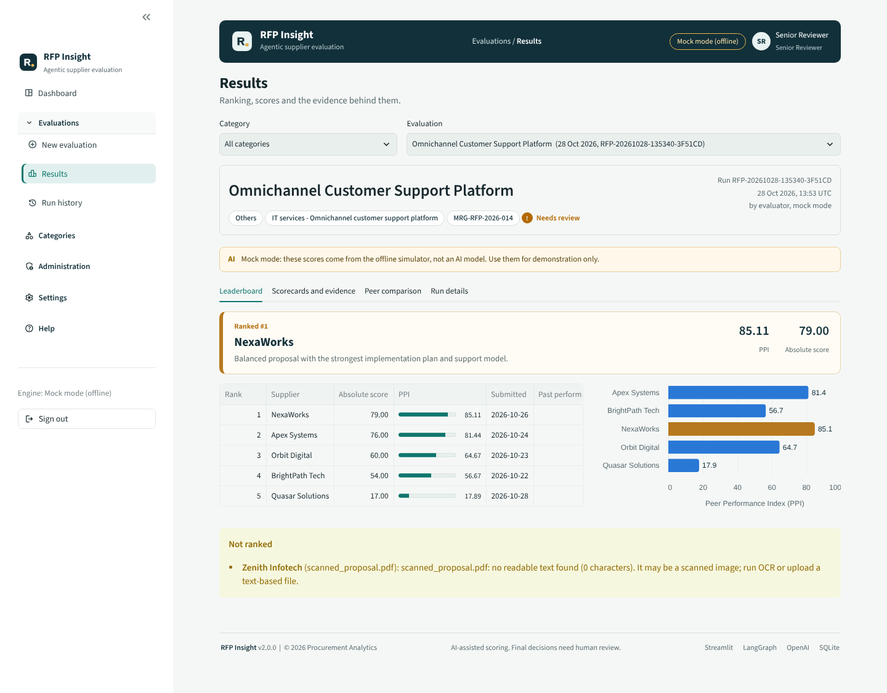 | 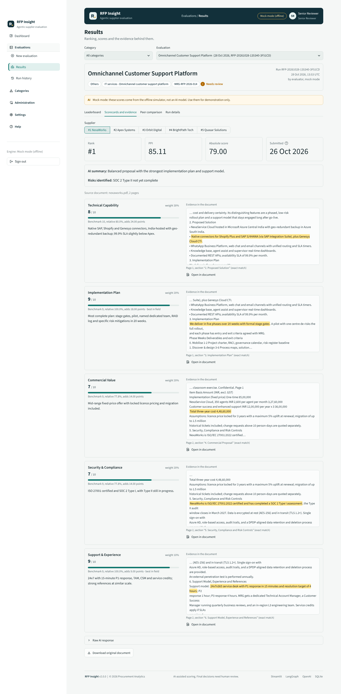 |
| 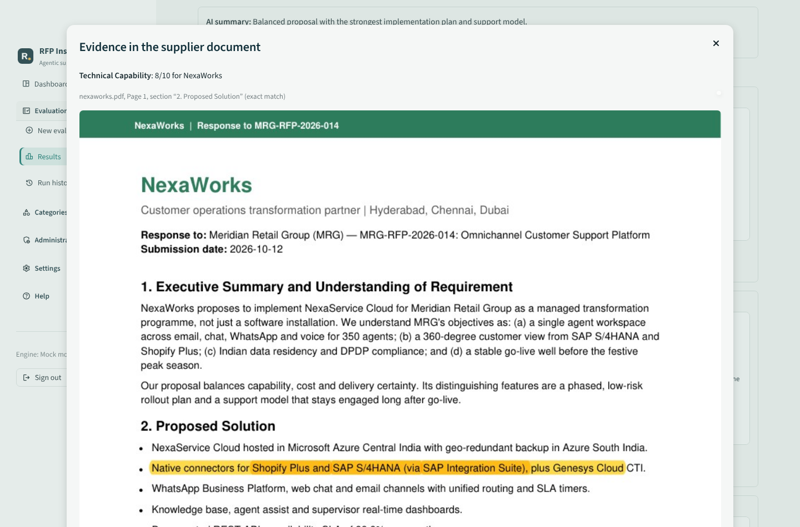 | 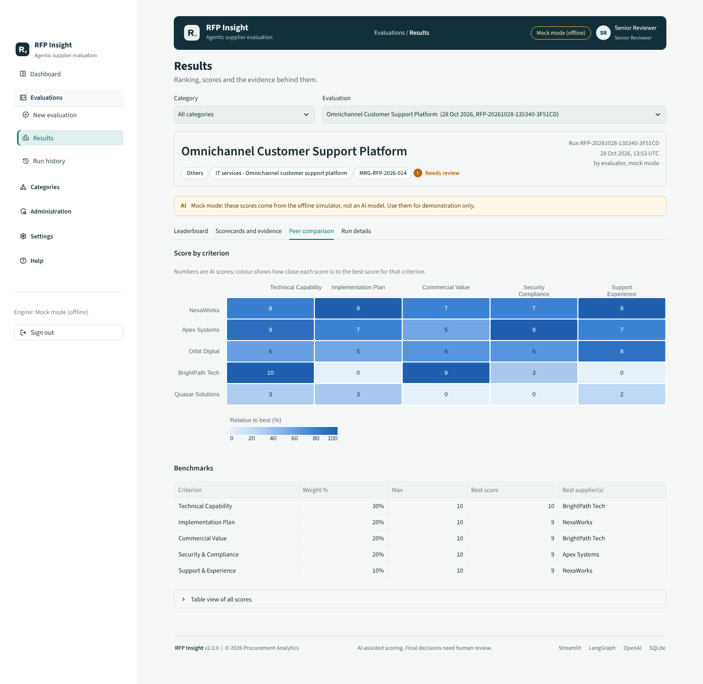 |
| 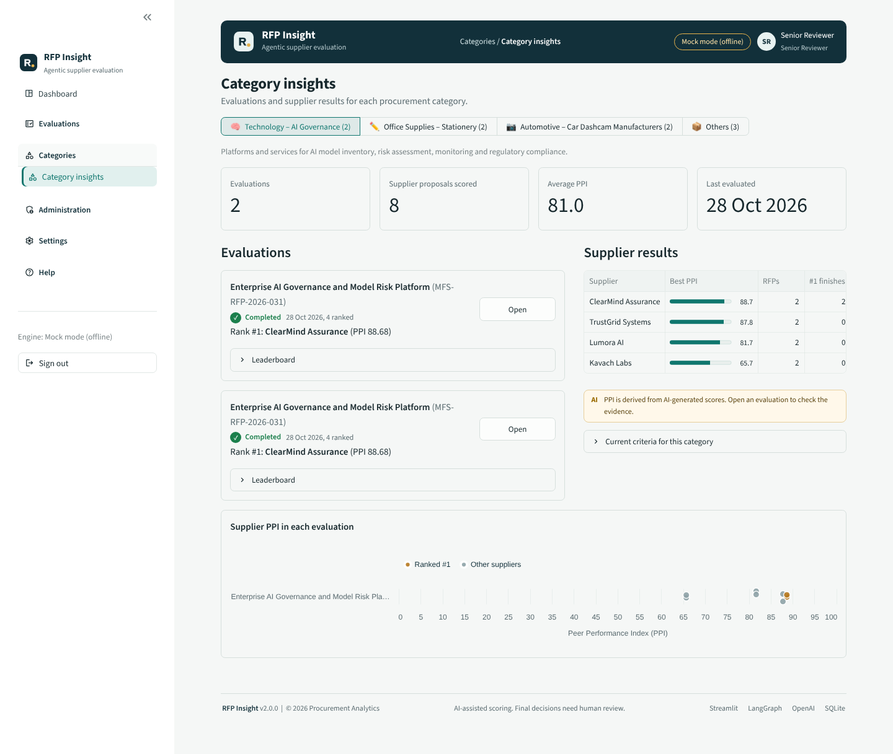 | 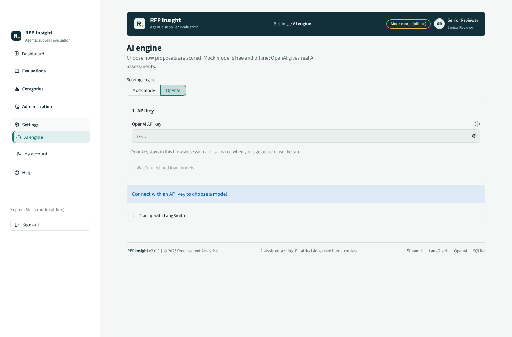 |
| 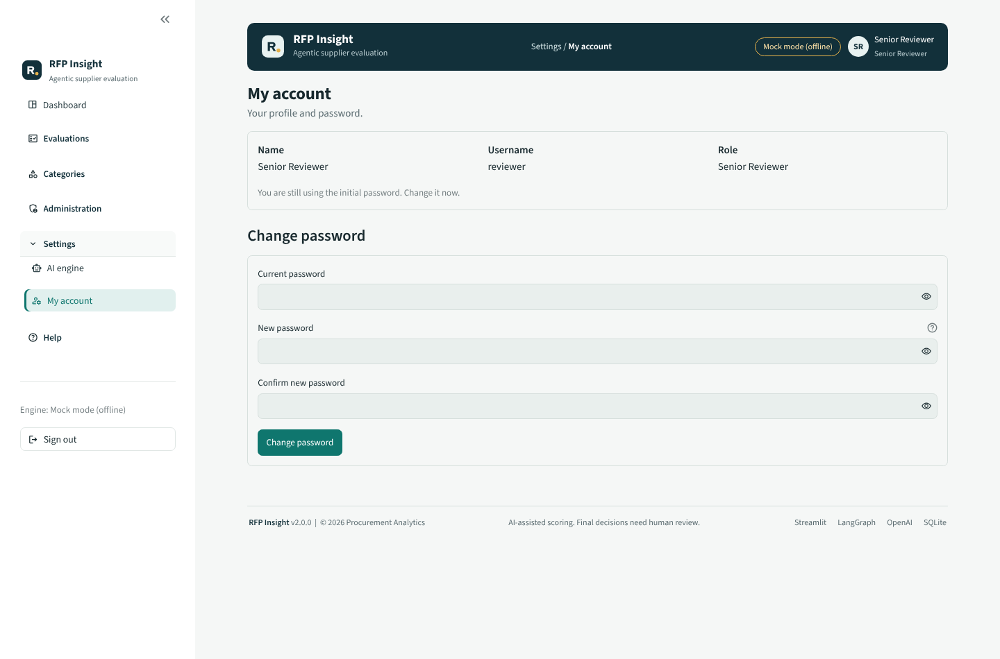 | 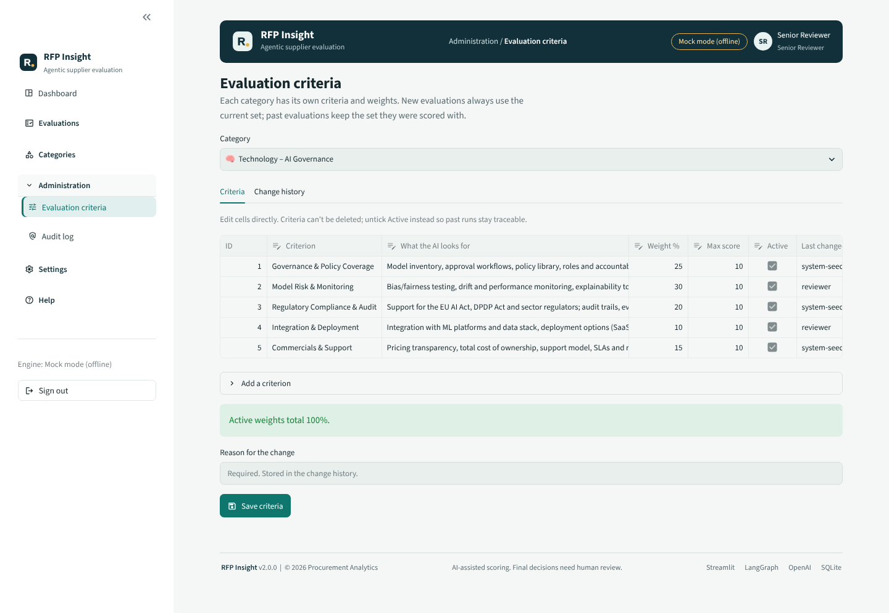 |
